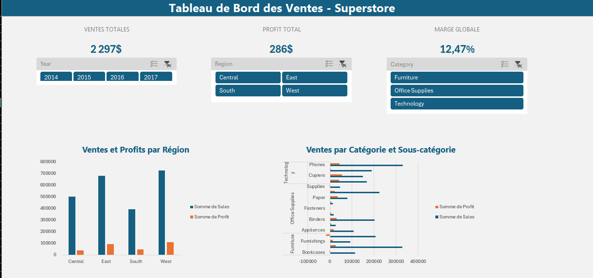
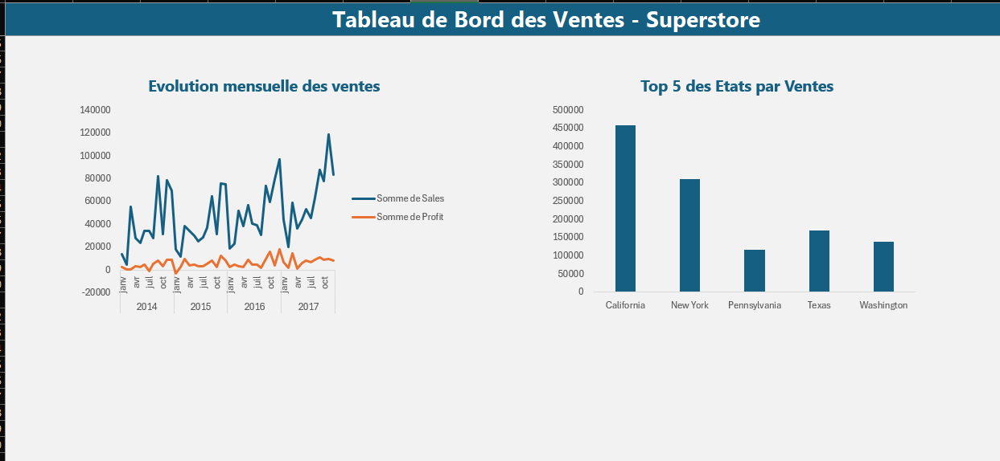
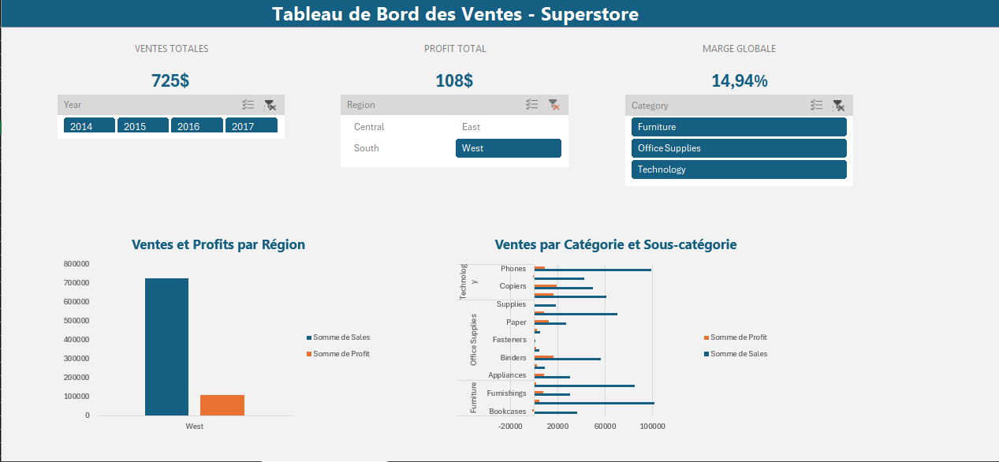
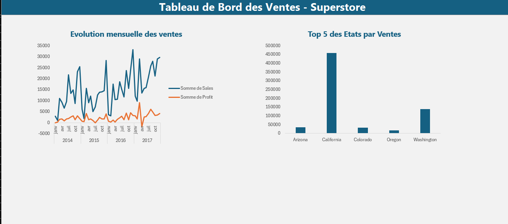

# Projet 1 : Tableau de bord des ventes (Excel)

## Contexte
Une entreprise de distribution souhaite suivre ses ventes et sa rentabilité
par région, catégorie de produit et période.

## Objectif
Construire un tableau de bord interactif pour suivre les KPI clés :
ventes, profit, marge, performances par région et par catégorie.

## Données
Superstore Dataset (Kaggle) : environ 9 994 lignes de commandes, 2014 à 2017.

## Contenu du classeur
- `Donnees_Ventes` : données source (table Excel) avec colonnes calculées (mois, année)
- `Calculs` : KPI avec SOMME, MOYENNE, MOYENNE.SI, RECHERCHEV, INDEX/EQUIV
- `TCD` : tableaux croisés dynamiques (région, catégorie, sous-catégorie, temps, États)
- `DASHBOARD` : tableau de bord avec 3 KPI, 4 graphiques et 3 segments
- Les onglets `TCD` (tableaux croisés dynamiques) et `Calculs` (formules) sont masqués : clic droit sur un onglet, puis « Afficher ».
## Aperçu

## Principaux constats
- Ventes totales : 2,30 M ; profit : 286 k ; marge globale : 12,5 %.
- West est la région la plus rentable (marge 14,9 %) ; Central la moins rentable (7,9 %).
- Furniture a une marge de 2,5 %, contre 17 % pour Technology et Office Supplies.
- Les ventes connaîssent une évolution globalement positive sur la période 2014-2017, malgré un léger recul en 2015. L'analyse mensuelle révèle une concentration des ventes en septembre, novembre et décembre, avec un pic particulièrement marqué en novembre.

## Utilisation
Télécharger `dashboard/Tableau_de_Bord.xlsx` et l'ouvrir dans Excel. Les segments
filtrent l'ensemble du tableau de bord.

## Compétences démontrées
Tableaux croisés dynamiques, segments, graphiques dynamiques, formules de recherche,
indicateurs de performance (KPI), analyse de rentabilité, conception de tableau de bord.